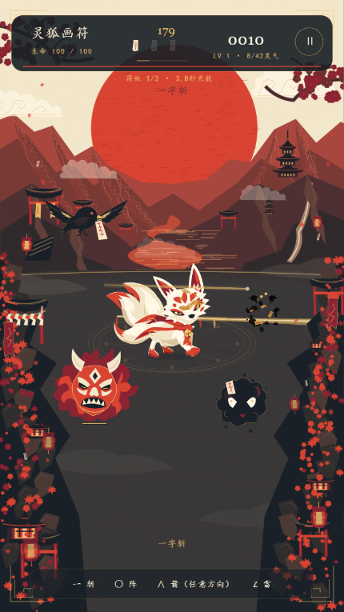
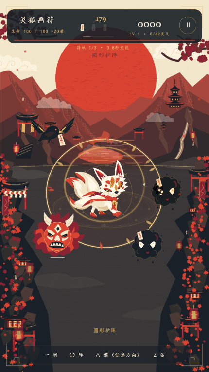
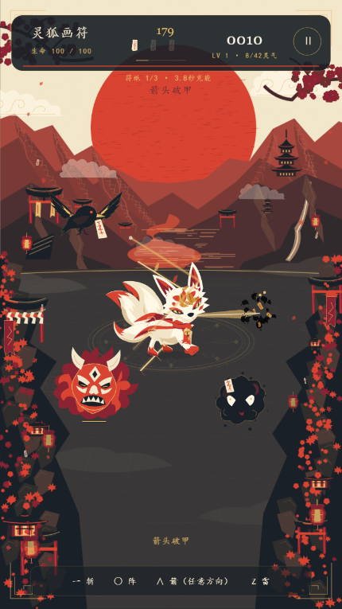
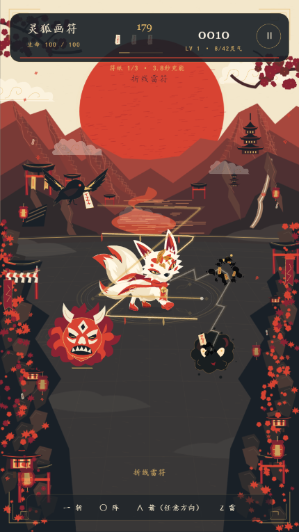

# 四种符术评审稿

当前玩家入口仅识别直线、圆、箭头、Z。星和螺旋暂缓，旧技能逻辑保留以便后续恢复。所有技能一笔完成，最多4秒，松手释放；绘制时战斗速度20%，符纸每5秒战斗时间恢复1张，上限3张。数值使用720×1280游戏坐标。

## 判定与方向

- 直线：笔迹基本笔直，起点到终点决定攻击方向，任意角度均可。
- 圆：首尾接近，绕中心一圈；允许一定椭圆比例。护阵始终以狐狸为中心。
- 箭头：两条较直的边相接成尖角，支持∧、V、<、>及斜向。以两端中点指向尖角决定攻击方向；反向绘制不会改变箭头朝向。两边允许不等长。内部沿用triangle技能标识，但不再要求画闭合三角。
- Z：三段折线，允许旋转、反向绘制、镜像；攻击方向取笔迹起点到终点。转向和比例允许一定误差。
- 过短不扣纸；有效但不匹配的笔迹扣1张纸，触发8基础伤害的弱散墨符。

## 基础效果与现有特效

以下数值不包含法宝、修行和敌人护甲。识别质量使基础伤害乘以80%–100%。

| 技能 | 战斗效果 | 当前特效 |
|---|---|---|
| 一字斩 | 60基础伤害；射程500、宽70；最多穿透3敌；同一次对同敌只伤害一次 | 玩家直线转为金色符迹，狐狸向绘制方向释放金色刀芒，白色细线作为亮芯；命中有碎纸/墨粒和轻微震屏。约0.7秒消退 |
| 圆形护阵 | 狐狸周围半径200，30基础范围伤害；获得20护盾，最多持续4秒，并击退敌人 | 玩家圆形转为狐狸周围的金色环阵，有朱红、金色纸雕火焰和刻线，缓慢旋转并淡出。环阵沿用手绘比例；逻辑判定范围为圆形 |
| 箭头破甲 | 尖角方向、射程520的扇区优先索敌；110基础单体伤害；目标3秒内额外承受25%伤害；移除鬼王护甲并打断蓄力 | 开放的金色箭头符迹，不补成三角；先显示方向金芒，释放后收束为指向实际目标的金色尖矢、白色亮芯。约0.85秒消退 |
| 折线雷符 | Lv1/2/3/4分别攻击1/3/6/8目标；基础伤害45，等级倍率1/1.5/2.2/3.5；前三阶逐跳乘0.9，Lv4每目标全额伤害；Lv3/4附加感电 | 纯矢量：单道引雷 → 云带奔雷 → 三卷雷诏 → 天狐山海开卷、八道天雷；命中与逐段落雷同步，持续1.15/1.85/2.65/4.5秒 |

前三阶雷符与箭头的首目标按距离、是否蓄力、精英/鬼王权重选择，扇区约139度；不会精确沿一条射线命中。没有目标时仍消耗符纸并显示符迹。

## 实际游戏截图

截图来自更新后的开发复现场景，使用真实识别、战斗和渲染器，无局内法宝。它们是动画中间帧，不能代表完整动画；死亡目标可能已变成粒子。

### 一字斩

### 圆形护阵

### 箭头破甲

### 折线雷符

## 建议评审重点

1. 金色符迹与背景、狐狸重叠时是否足够清楚；四种技能是否可一眼区分。
2. 箭头的索敌宽容度是否符合玩家预期；Z的起终点方向是否容易理解。
3. 圆阵是否需要单独的护盾破碎、耗尽反馈；现有阵纹不会显示剩余护盾数值。
4. 直线刀芒、箭头尖矢的速度感，以及雷链亮度、持续时间是否需要调整。

验证：27组测试通过（含16方向箭头/Z、逆向绘制、旧星/螺旋不再识别）；正式构建通过；四个真实渲染复现场景成功且无浏览器脚本错误。真人手绘成功率仍需试玩评审。

Z四阶新版预览：`?lab=1&thunder=1`。Lv4按范围选择八个目标，不受首目标扇区限制。前三阶保持方向索敌与280距离连锁；起势后选定目标，落雷前跟随目标位置，已死亡目标不再造成伤害，同一目标每次施法只命中一次。
